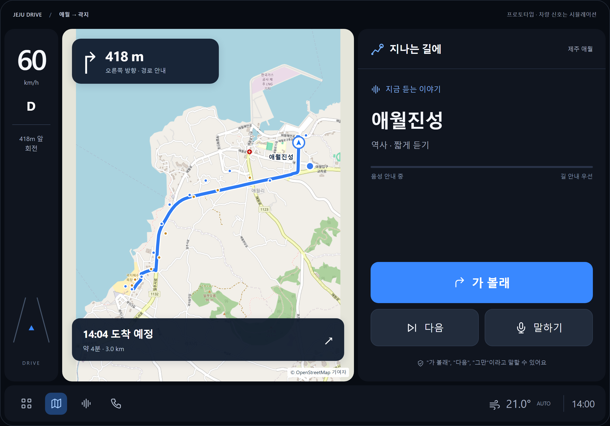

# 차량용 위치 큐레이션 앱 (가칭 지나는 길에)

현대자동차그룹 차량용 앱 개발 공모전 작업 저장소. **접수 마감 2026-11-15 23:59.**

## 지도 중심형 디자인 실행

1. 저장소를 내려받아 **`prototype/index.html`**을 브라우저로 연다. 설치 없이 작동한다.
2. 오른쪽 **주행 시작**으로 이야기를 듣고, **기어 P**로 방문 기록·쿠폰·관심사를 확인한다.
3. **폰 앱 보기**에서 쿠폰함과 가게 광고 등록을 확인한다.
4. **`design/index.html`**을 열면 적용한 화면 12장의 캡처를 모아 볼 수 있다.

지도 배경, 아이콘, 글꼴은 실행 중 외부 요청 없이 표시된다. 지도는 제주 시연 구간용이며 실제 길 안내는 차량 내비가 담당한다. 디자인·검사 설명은 [design/README.md](design/README.md)에 있다.

### 적용 화면 미리보기

## 담당
- **A = 대표자**: `prototype/a/`, `prototype/phone/`, `android/`, GitHub, 기획서 5번
- **B = 팀원**: `prototype/b/`, 제주 콘텐츠, 화면 시안, 시연 영상, 기획서 6번

## 팀원(B)이 먼저 할 일
1. `prototype/CLAUDE.md`를 읽는다. AI로 작업할 때도 이 폴더에서 시작한다.
2. Chrome으로 `prototype/index.html`을 열어 "주행 시작"을 눌러 본다. 설치할 것은 없다.
3. `prototype/b/content.js`에 제주 장소 글과 가상 홍보 문구를 쓴다.

## 정해진 것
- **시연 경로: 애월~곽지 일주서로 구간** (약 3.1km, 60km/h로 약 3분). 해안도로가 아니다. 콘텐츠는 이 경로 근처 장소로 쓴다.
- 콘텐츠 20~30곳. 실제 장소의 이야기는 **출처를 확인**하고, 홍보 상호는 전부 가상으로 쓴다.
- 지금 `content.js`의 글과 좌표는 예시다. 경로에서 먼 좌표를 쓰면 재생 시점이 어긋난다.
- 15일 제출: 기획서(필수), 화면 시안, 웹 프로토타입 시연 영상. 실제 SDK 앱은 되면 추가한다.
- 영상과 기획서에 "차량 신호는 시뮬레이션"이라고 밝히고, 영상 끝에 지도 출처(OpenStreetMap 기여자)를 표기한다.
- 저장소, 영상, 링크에 실명과 계정 정보가 드러나지 않게 한다.

## 문서
| 파일 | 내용 |
|---|---|
| `06_기획서_초안.md` | 기획서 초안, 분담, 일정 |
| `07_에뮬레이터_시험결과.md` | 실제 Pleos 에뮬레이터 시험 결과와 개발 시 주의점 |
| `02_Pleos_개발환경_제약_원문정리.md` | Pleos 개발 환경과 규제 |
| `03_논의용_평가기준_기술_데이터.md` | 심사 기준, 쓸 수 있는 기술과 데이터 |
